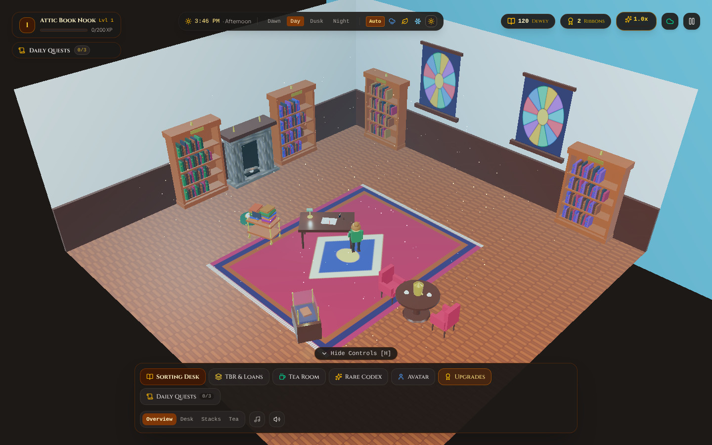
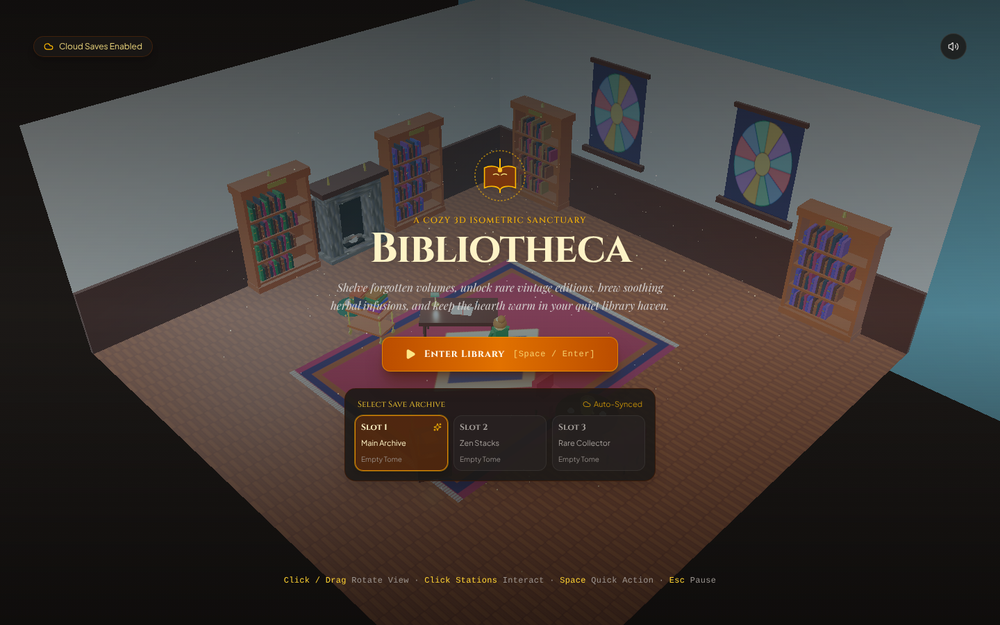
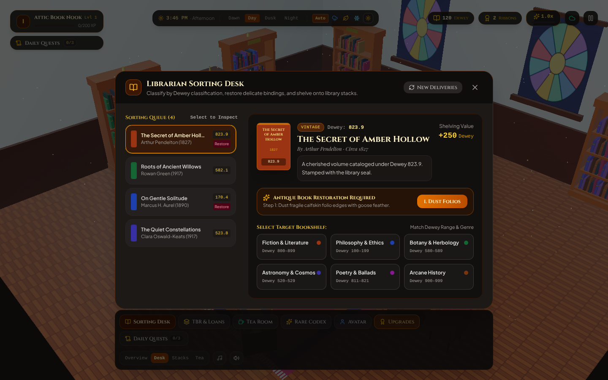
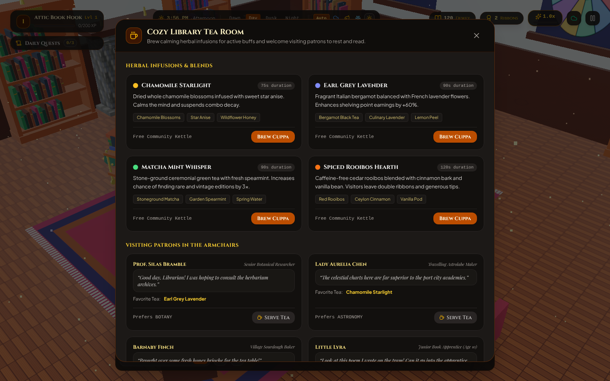

# Bibliotheca

**A cozy 3D isometric book-organizing game.** Shelve forgotten volumes by their Dewey Decimal class, restore fragile antique editions, brew herbal teas for your patrons, and keep the hearth warm in a quiet little library as day turns to night and the weather drifts by outside.

<p align="center">
  
</p>

<p align="center">
  <a href="https://ai.studio/apps/0d7611e2-3858-447d-92c8-8545be022b92"><strong>Play the live preview</strong></a>
</p>

---

## Table of contents

- [About the game](#about-the-game)
- [How to play](#how-to-play)
- [Features](#features)
- [Screenshots](#screenshots)
- [Controls](#controls)
- [Getting started](#getting-started)
- [Tech stack](#tech-stack)
- [Project structure](#project-structure)
- [Saving your progress](#saving-your-progress)

---

## About the game

Bibliotheca is a relaxed, low-pressure management game set in a single warm library room, rendered in 3D with Three.js. There is no fail state. You work through a queue of delivered books, learn which shelf each one belongs on, and slowly grow the library with upgrades, rare finds, and a cast of friendly visitors.

The whole game runs in the browser. It uses synthesized sound effects and an optional lo-fi ambient soundtrack generated live with the Web Audio API, so there are no audio files to download.

## How to play

1. **Enter the library** from the title screen and choose one of three save slots.
2. **Open the Sorting Desk** (or click the desk or a bookshelf in the 3D room). Each delivered book shows its title, author, year, rarity, condition, lore, and Dewey number.
3. **Restore damaged books.** Antique volumes marked "needs restoration" take a three-step treatment: dust the folio edges, rebind the spine with beeswax, then apply a gold-leaf seal. Restored books are worth 50% more.
4. **Shelve each book on the matching shelf** by genre and Dewey range. A wrong shelf shows a classification mismatch message and the book stays in the queue.
5. **Build a combo.** Every correct shelving adds 0.5x to your multiplier, up to 5x. The multiplier decays after 10 seconds unless you keep shelving.
6. **Earn Dewey Points, Gilded Ribbons, and XP.** Spend points and ribbons on upgrades, and level up to unlock more of the library.

| Genre | Dewey range |
| --- | --- |
| Philosophy and Ethics | 100-199 |
| Astronomy and Cosmos | 520-529 |
| Botany and Herbology | 580-589 |
| Fiction and Literature | 800-899 |
| Poetry and Ballads | 811-821 |
| Arcane History | 900-999 |

## Features

### Sorting Desk
The main loop of the game. Pull fresh deliveries, inspect each book, restore the fragile ones, and shelve them for points. Rare, vintage, and mythic books you shelve are added to your Codex.

### TBR Cart and Loan Ledger
- **TBR cart:** move unread books from the cart onto the sorting desk.
- **Loaned-out books:** send reminders to patrons and collect returns for rewards.
- **Borrowed-in books:** catalog books borrowed from other libraries for bonus points and ribbons.

### Tea Room and visiting patrons
Brew one of four herbal teas for a timed buff, then serve patrons their favorite blend. Each patron leaves a thank-you note in the guestbook.

| Tea | Effect | Duration |
| --- | --- | --- |
| Chamomile Starlight | Combo timer stops decaying | 75 s |
| Earl Grey Lavender | +60% Dewey Points from shelving | 90 s |
| Matcha Mint Whisper | Better odds of rare and vintage deliveries | 90 s |
| Spiced Rooibos Hearth | Double rewards from patrons | 120 s |

Visitors include Prof. Silas Bramble, Lady Aurelia Chen, Barnaby Finch, and Little Lyra, each with their own preferred genre and favorite tea.

### Rare Vintage Codex
A collection log of eight antique editions, from *The Cartography of Cloud Islands* (1782) to *Chronicles of the Sunken Shire* (1730, mythic). Shelve rare books to unlock more entries.

### Daily Quests
Three new quests appear every calendar day, picked from a pool of twelve: shelve books of a certain genre, restore antique editions, reach a combo target, brew tea, clear the TBR cart, or process loan returns. You can reroll a quest, and completing all three earns a bonus of 450 Dewey Points and 4 Gilded Ribbons.

### Upgrades
Spend Dewey Points and Gilded Ribbons to improve the library. Perk text below is as shown in the game.

| Upgrade | Category | Cost | Level | Perk |
| --- | --- | --- | --- | --- |
| Polished Oak Stacks | Shelving | 250 pts, 2 ribbons | 1 | +25% Dewey Points per shelved book |
| Russian Brass Samovar | Tea Room | 400 pts, 4 ribbons | 2 | Longer tea buffs and townsfolk who stay to chat |
| Gilded Glass Vitrine | Sanctuary | 600 pts, 6 ribbons | 2 | Displays restored vintage books |
| Barnaby the Calico Cat | Aesthetics | 850 pts, 8 ribbons | 3 | Combo window grows from 10 s to 15 s |
| Cathedral Stained Glass | Aesthetics | 1,200 pts, 12 ribbons | 3 | Prismatic light patterns by day |
| Stone Hearth Fireplace | Tea Room | 1,600 pts, 15 ribbons | 4 | Warm flickering light at night |

You can also pet Barnaby the cat in the 3D room for a little confetti.

### Librarian avatar editor
Customize your librarian, Elspeth, with hairstyles (classic bun, scholar beret, messy curls, side part, wizard hat, headphones), hair and skin colors, eyewear, outfit style and colors, and a handheld accessory (cup of tea, feather quill, brass lantern, or vintage tome). Changes appear live on the 3D character.

### Day-night cycle and weather
A full 24-hour cycle plays out over about 10 minutes of real time, with the lighting shifting from dawn to noon to dusk to night. Weather drifts between clear skies, soft rain, falling autumn leaves, and gentle snow based on the time of day. You can jump to a time of day or pick the weather yourself from the top bar.

### Sound
Sound effects for shelving (which rise in pitch with your combo), restoring, brewing, upgrading, and the chiming clock are all synthesized in the browser. A lo-fi ambient chord loop can be toggled on and off.

### Camera
Click and drag to rotate the view, or jump between presets: Overview, Desk, Stacks, and Tea.

## Screenshots

<table>
  <tr>
    <td align="center" width="33%">
      <br>
      <sub>Title screen and save slots</sub>
    </td>
    <td align="center" width="33%">
      <br>
      <sub>Librarian Sorting Desk</sub>
    </td>
    <td align="center" width="33%">
      <br>
      <sub>Tea Room and visiting patrons</sub>
    </td>
  </tr>
</table>

## Controls

| Input | Action |
| --- | --- |
| Click and drag | Rotate the 3D view |
| Click a station in the room | Open the matching screen (desk, TBR cart, tea room, vitrine, librarian) |
| Bottom dock buttons | Open Sorting Desk, TBR and Loans, Tea Room, Rare Codex, Avatar, Upgrades, or Daily Quests |
| `Space` or `Enter` | Start the game from the title screen |
| `Esc` | Close the open window, or pause and resume |
| `H` | Hide or show the bottom controls |

## Getting started

### Prerequisites

- [Bun](https://bun.sh) (recommended, since the repo ships a `bun.lock`), or Node.js 22 or newer with npm
- An internet connection when you play, because fonts are loaded from Google Fonts

No API keys are needed to run the game.

### Run it locally

```bash
git clone https://github.com/VincentKovar/Bibliotheca.git
cd Bibliotheca

# With Bun
bun install
bun run dev

# Or with npm
npm install --legacy-peer-deps
npm run dev
```

Then open <http://localhost:3000>.

> **Note:** a plain `npm install` currently stops with a dependency conflict between the pinned `esbuild` version and Vite 8. Adding `--legacy-peer-deps` works around it, and Bun installs without any flags.

### Available scripts

| Command | What it does |
| --- | --- |
| `dev` | Starts the Vite dev server on port 3000 |
| `build` | Creates a production build in `dist/` |
| `preview` | Serves the production build locally |
| `lint` | Type-checks the project with `tsc --noEmit` |
| `clean` | Removes the `dist/` folder |

Run any of these with `bun run <script>` or `npm run <script>`.

## Tech stack

- **React 19** and **TypeScript** for the interface and game state
- **Three.js** for the isometric 3D library scene, character, lighting, and weather particles
- **Vite 8** for development and builds
- **Tailwind CSS 4** for styling
- **Motion** and **canvas-confetti** for animation and celebration effects
- **Lucide React** for icons
- **Web Audio API** for all sound effects and ambient music
- Fonts: Cinzel, Playfair Display, and Plus Jakarta Sans

The project was scaffolded with [Google AI Studio](https://ai.studio).

## Project structure

```
Bibliotheca/
├── index.html
├── metadata.json            # AI Studio app name and description
├── vite.config.ts
├── docs/
│   └── screenshots/         # Images used in this README
└── src/
    ├── App.tsx              # Game state, combo logic, quests, autosave
    ├── main.tsx
    ├── index.css
    ├── audio/
    │   └── synthAudio.ts    # Synthesized sound effects and lo-fi ambience
    ├── components/          # HUD, title screen, and all the modal windows
    ├── game/
    │   ├── bookGenerator.ts # Books, teas, visitors, and upgrade data
    │   ├── questGenerator.ts# Daily quest pool and date-based selection
    │   ├── cloudSave.ts     # Save slots, export, and import
    │   └── three/           # 3D scene, models, textures, and the librarian
    └── types/
        └── game.ts          # Shared TypeScript types
```

## Saving your progress

Bibliotheca has three save slots (Main Archive, Zen Stacks, and Rare Collector). The game autosaves every 18 seconds while you play, and the pause menu lets you save manually, export a save as a JSON file, or import one.

Saves are stored in your browser's local storage, so they stay on the device and browser you play on. The game also tries to send each save to an `/api/cloud-save` endpoint, but this repository does not include a server for it, so exporting a JSON backup is the way to move progress between devices.
